# PHP2Shell Detection with Wazuh 4.14.8 (4.14.x series) - CVE-2026-109618 and CVE-2026-109619

> **Detection engineering for the PHP2Shell memory-safety flaws · Apache mod_php on Linux · lab-validated on Ubuntu 24.04 LTS**

Wazuh 4.14.8 | 6 rules | 3 decoders | SCA policy with 5 checks | MITRE T1190, T1499, T1005 | CVSS v4 9.2

---

## What is PHP2Shell?

PHP2Shell is a family of memory-safety bugs in the PHP engine. A fatal error, most usefully an out-of-memory fatal at `memory_limit`, interrupts a non-atomic internal operation and leaves state behind that later code trusts. The flaws are remote and unauthenticated, do not depend on a bug in the application, and reach back to PHP 5.4 according to the researchers.

Two CVEs describe the issues, titled as in the PHP security advisory:

- **CVE-2026-109618, RCE via OOM corruption**: out-of-memory handling can interrupt PHP while internal request data is only partially initialized, and request cleanup may then treat the invalid data as valid.
- **CVE-2026-109619, RCE via stale global state**: request-owned internal state can survive after its backing memory has been freed, and a later request handled by the same worker may use that stale state before normal initialization resets it.

The researchers also describe a remote process-memory disclosure in which reclaimed heap contents are URL-encoded into a `PHPSESSID` response cookie. The advisory lists its interim measures under each CVE separately, and the rules in this repository treat the observable symptoms as consistent with both CVEs.

Researchers demonstrated unauthenticated RCE against WordPress, Drupal and Joomla.

Because the exploit runs below the application layer, application logs show little. The Wiz advisory lists the observable signals this repository detects: multipart requests followed by memory-limit errors, repeated HTTP 500 responses, malformed or oversized `PHPSESSID` response cookies, and PHP worker churn.

> Disclosed by Wiz Research (Sagi Tzadik, Shir Tamari, Nir Ohfeld, Tomer Schwartz), with a technical write-up by Calif. Fixed in PHP 8.5.12, 8.4.27, 8.3.36 and 8.2.35.

---

## Official References

| Resource | Link |
|---|---|
| PHP security advisory (2026-10-21) | https://www.php.net/archive/2026.php#2026-10-21-5 |
| PHP pre-announcement with the CVSS score (2026-10-20) | https://www.php.net/archive/2026.php#2026-10-20-1 |
| Wiz Research write-up | https://www.wiz.io/blog/php2shell-php-rce |
| Calif technical write-up | https://calif.io/php2shell/ |
| Wazuh rules syntax | https://documentation.wazuh.com/current/user-manual/ruleset/ruleset-xml-syntax/rules.html |
| Wazuh decoders syntax | https://documentation.wazuh.com/current/user-manual/ruleset/ruleset-xml-syntax/decoders.html |
| Wazuh custom SCA policies | https://documentation.wazuh.com/current/user-manual/capabilities/sec-config-assessment/creating-custom-policies.html |
| MITRE ATT&CK T1190 | https://attack.mitre.org/techniques/T1190/ |

---

## Why a Dedicated Detection Layer

An unpatched PHP engine cannot be told apart from a patched one by looking at `php -v` on distributions that backport the fix. On Ubuntu 24.04 the package `8.3.6-0ubuntu0.24.04.13` contains the fix while `php -v` still reports 8.3.6. Detection therefore has two independent layers:

```
Layer 1 - Behavior (rules)   : OOM fatals, repeated 500s, worker churn,
                               chunked multipart, anomalous PHPSESSID cookie
Layer 2 - Exposure (SCA)     : package revision with the backport,
                               interim mitigations from the PHP advisory
```

The rules detect the observable pre-conditions and symptoms described in the official sources. A single event does not prove exploitation, and the rule descriptions say "consistent with" on purpose.

---

## What Changed in v1.1

- **CVE attribution.** Rule 100131 and the README now follow the titles in the PHP advisory and name both CVEs.
- **No cookies in alerts.** Rules 100130 and 100131 use `no_full_log`, and the decoder no longer extracts the `Set-Cookie` header into a field. Rule 100131 matches the raw log line inside the analysis engine, so the cookie values are never stored in the alert. A sibling decoder stores only the first 8 characters of a `PHPSESSID` cookie in `data.phpsessid_prefix`, enough to see the shape of an anomalous value.
- **`same_srcip`.** Rules 100101 and 100120 use `same_srcip`.
- **SCA effective values.** Checks 109601 to 109603 pass when the installed package carries the vendor backport, or when the interim mitigation is effective. The effective value is computed by the PHP CLI started with the Apache `php.ini` and the Apache `conf.d` scan directory, and read with `ini_get()`, so every drop-in is applied in the order PHP loads them. A patched host is no longer penalized for interim mitigations it does not need.
- **SCA check 109604.** New check that searches `/etc/apache2` and the `.htaccess` files under `/var/www` for `php_value`, `php_admin_value`, `php_flag` and `php_admin_flag` lines that undo a mitigation. Commented lines are ignored, and `php_admin_value memory_limit -1`, the setting the advisory recommends, is not flagged.

---

## Exploit Chain

```
Step 1: multipart POST          chunked or lengthless body bypasses post_max_size
Step 2: filename="" parts       nested empty-filename parts exhaust memory_limit
Step 3: fatal error     [!]     TRIGGER - allocation fails at a chosen point
Step 4: stale state             cleanup still runs in mod_php, pointers reference freed heap
Step 5: next multipart request  freed heap is URL-encoded into the PHPSESSID cookie
Step 6: RCE                     unauthenticated code execution (WordPress, Drupal, Joomla)
```

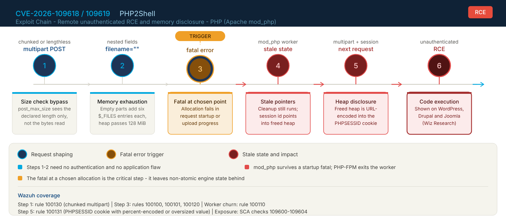

`post_max_size` is compared with the declared `Content-Length`, not with the bytes actually read, so chunked HTTP/1.1 and lengthless HTTP/2 multipart requests bypass it. On mod_php the request cleanup still runs after a startup fatal, which is why mod_php carries the highest risk. On PHP-FPM a startup failure exits the worker, and exploitation needs a post-startup decoding operation.

---

## Repository Structure

```
PHP2Shell-Detection-with-Wazuh/
│
├── SECURITY.md                              # Vulnerability reporting policy
│
├── rules/
│   └── php2shell_rules.xml                  # 6 Wazuh rules (100100-100131)
│
├── decoders/
│   └── php2shell_decoders.xml               # parent decoder and two sibling field decoders for the php2shell access log
│
├── apache/
│   └── php2shell-logformat.conf             # LogFormat and CustomLog for Apache 2.4
│
├── sca/
│   └── php2shell_cve_2026_109618_109619.yml # SCA policy - Ubuntu 24.04, PHP 8.3, mod_php
│
└── docs/
    ├── exploit_chain_timeline.png           # Exploit chain diagram
    ├── rule_100130_v11.png                  # Rule 100130, v1.1 alert (no full_log, no set_cookie)
    ├── rule_100131_v11.png                  # Rule 100131, v1.1 alert (no full_log, no set_cookie)
    ├── rule_100131-rev2.png                 # Rule 100131 with data.phpsessid_prefix (sibling decoder)
    ├── rules_100101_100120_v11.png          # Rules 100101 and 100120 with same_srcip
    ├── rules_100100_100101.png              # Rules 100100 and 100101, OOM fatals
    ├── sca_policy.png                       # SCA v1.0, unpatched endpoint (25%)
    ├── sca_policy_pos_up.png                # SCA v1.0, patched endpoint (50%)
    ├── sca_policy_revision.png              # SCA v1.1 final commands, patched endpoint (100%)
    ├── sca_policy_revision-2_score80.png    # SCA v1.1 final commands, mitigations through conf.d (80%)
    ├── sca_policy_revision-2_score20.png    # SCA v1.1 final commands, no mitigation and Apache override (20%)
    └── sca_events.png                       # SCA events indexed in Discover (v1.0)
```

---

## Detection Architecture

### Rule Chain

| Rule | Parent | Signal | Level | Evidence |
|---|---|---|---|---|
| **100100** | 30301 | PHP `Allowed memory size ... exhausted` fatal in the Apache error log | 6 | Logtest and Discover |
| **100101** | 100100, `same_srcip` | 6 OOM fatals in 120 s from one IP | 10 | Logtest and Discover |
| **100110** | 30304, frequency | 4 Apache worker segmentation faults in 120 s | 13 | Logtest only |
| **100120** | 31122, `same_srcip` | 5 HTTP 500 responses in 60 s from one IP | 8 | Logtest and Discover |
| **100130** | php2shell-accesslog | Multipart request with `Transfer-Encoding: chunked` | 7 | Logtest and Discover |
| **100131** | php2shell-accesslog | `PHPSESSID` response cookie with `%XX` bytes or 64+ characters | 10 | Logtest and Discover |

> **Engineering notes from validation on Wazuh 4.14.8**
>
> - The native PHP fatal chain (31402, 31405, 31420) does not match the Apache 2.4 error log format. In `wazuh-logtest` the event stops at rule 30301, so rule 100100 inherits from 30301 and matches the message itself.
> - Native Apache 2.4 segfault events end at rule 30304, not 30104. Frequency rules count only events whose final matched rule is the referenced SID, so 100110 uses 30304.
> - Access log events with status 500 end at rule 31122, so 100120 uses 31122 and not 31120.
> - The native `web-accesslog` decoder has a prematch that accepts extra tokens before the bracketed timestamp, so any combined-style prefix is claimed by it. The `php2shell` format is key=value without brackets, which the native decoder does not match.
> - Rules 100130 and 100131 use `no_full_log`. Rule 100131 matches the raw log line with a PCRE2 `regex`, which still works when `full_log` is omitted from the alert.

### Decoder

The `php2shell-accesslog` decoder and its child extract `srcip`, `protocol` (method), `url`, `id` (status), `content_type`, `transfer_encoding` and `content_length` from the custom access log line. The `Set-Cookie` header is intentionally not extracted. A sibling decoder, which Wazuh evaluates in parallel because it has the same name and parent, stores only the first 8 characters of a `PHPSESSID` response cookie in `phpsessid_prefix`. The two child decoders must stay adjacent and keep the same name.

---

## Deployment

### Step 1 - Add the Apache log format (endpoint)

Add the two lines from `apache/php2shell-logformat.conf` inside the VirtualHost you want to monitor, then validate and reload:

```bash
apachectl configtest && systemctl reload apache2
chown root:adm /var/log/apache2/php2shell_access.log && chmod 640 /var/log/apache2/php2shell_access.log
```

### Step 2 - Collect the logs (endpoint `ossec.conf`)

```xml
<localfile>
  <log_format>apache</log_format>
  <location>/var/log/apache2/error.log</location>
</localfile>

<localfile>
  <log_format>apache</log_format>
  <location>/var/log/apache2/access.log</location>
</localfile>

<localfile>
  <log_format>syslog</log_format>
  <location>/var/log/apache2/php2shell_access.log</location>
</localfile>
```

The first two feed the native Apache rules that rules 100100, 100110 and 100120 inherit from. The third feeds the decoder for rules 100130 and 100131.

### Step 3 - Deploy decoder and rules (manager)

```bash
cp decoders/php2shell_decoders.xml /var/ossec/etc/decoders/
cp rules/php2shell_rules.xml /var/ossec/etc/rules/
chown wazuh:wazuh /var/ossec/etc/decoders/php2shell_decoders.xml /var/ossec/etc/rules/php2shell_rules.xml
chmod 660 /var/ossec/etc/decoders/php2shell_decoders.xml /var/ossec/etc/rules/php2shell_rules.xml

# Syntax check - silent on success
/var/ossec/bin/wazuh-analysisd -t

systemctl restart wazuh-manager
```

`wazuh-logtest` reads the running `wazuh-analysisd`, so the manager restart is required before testing new rules or decoders.

### Step 4 - Deploy the SCA policy (endpoint)

```bash
mkdir -p /var/ossec/etc/custom-sca
cp sca/php2shell_cve_2026_109618_109619.yml /var/ossec/etc/custom-sca/
chown root:wazuh /var/ossec/etc/custom-sca/php2shell_cve_2026_109618_109619.yml
chmod 640 /var/ossec/etc/custom-sca/php2shell_cve_2026_109618_109619.yml
```

Register it inside the `<sca>` block of the endpoint `ossec.conf` and restart the agent:

```xml
<sca>
  <enabled>yes</enabled>
  <scan_on_start>yes</scan_on_start>
  <interval>12h</interval>
  <policies>
    <policy>/var/ossec/etc/custom-sca/php2shell_cve_2026_109618_109619.yml</policy>
  </policies>
</sca>
```

```bash
systemctl restart wazuh-agent
```

Checks 109601 to 109603 run the PHP CLI binary `php8.3` with the Apache `php.ini` and `conf.d`, so the `php8.3-cli` package must be installed on the endpoint. The policy was tested configured in the agent's local `ossec.conf`, where `sca.remote_commands` is not required for the command rules (`c:`) it uses. Delivery through centralized configuration (`agent.conf`) was not tested.

---

## Validation

### Decoder and rules by logtest (manager)

```bash
cat <<'EOF' | /var/ossec/bin/wazuh-logtest 2>&1 | grep -E '^\s+(name|srcip|url|transfer_encoding|id|level|phpsessid_prefix):|Alert to be generated|full event'
php2shell ip=127.0.0.1 ts="2026-10-22T11:45:00-0300" req="POST / HTTP/1.1" status=200 bytes=531 ref="-" ua="curl/8.5.0" ct="multipart/form-data; boundary=------------------------abc" te="chunked" cl="-" sc="-"
php2shell ip=127.0.0.1 ts="2026-10-22T11:45:00-0300" req="GET /cookie_test.php HTTP/1.1" status=200 bytes=531 ref="-" ua="curl/8.5.0" ct="-" te="-" cl="-" sc="PHPSESSID=a%00b%FF%41%7F%7F; path=/"
php2shell ip=10.0.0.9 ts="2026-10-22T11:45:00-0300" req="GET /x.php HTTP/1.1" status=200 bytes=531 ref="-" ua="curl/8.5.0" ct="-" te="-" cl="-" sc="PHPSESSID=abcdefghijklmnopqrstuvwxyz012345; path=/"
php2shell ip=10.0.0.9 ts="2026-10-22T11:45:00-0300" req="GET /y.php HTTP/1.1" status=200 bytes=531 ref="-" ua="curl/8.5.0" ct="-" te="-" cl="-" sc="foo=a%00b, PHPSESSID=abc123"
EOF
```

Observed result: line 1 fires 100130 (level 7) and line 2 fires 100131 (level 10) with `phpsessid_prefix: 'a%00b%FF'`. Line 3, a normal 32-character session ID, and line 4, a `%XX` value in a different cookie with a normal `PHPSESSID`, fire nothing. No decoded field holds a full cookie.

### Real events on the lab endpoint

These steps generate events with benign requests. They reproduce the observable symptoms, not an exploit.

```bash
# Rule 100130 - multipart request with chunked Transfer-Encoding
curl -s -o /dev/null -w 'HTTP %{http_code}\n' -H 'Transfer-Encoding: chunked' -F 'a=b' http://localhost/
```

```php
<?php
// Lab test: benign trigger that emits a percent-encoded PHPSESSID response cookie.
setcookie('PHPSESSID', "a\x00b\xffA\x7f");
```

```bash
# Rule 100131 - save the script above as /var/www/html/cookie_test.php
curl -si http://localhost/cookie_test.php | grep -i '^set-cookie'
```

```php
<?php
// Lab test: benign memory_limit exhaustion (lab only, never on a production host).
$a = [];
while (true) { $a[] = str_repeat('A', 1048576); }
```

```bash
# Rules 100100, 100101 and 100120 - save the script above as /var/www/html/oom_test.php
for i in 1 2 3 4 5 6; do curl -s -o /dev/null -w '%{http_code} ' http://localhost/oom_test.php; done; echo
```

---

## Validation Evidence

All screenshots come from the Wazuh Dashboard on the lab agent `labnix`. Environment: Wazuh 4.14.8 manager, Ubuntu 24.04.5 endpoint, Apache 2.4.58 prefork with mod_php 8.3.6.

### Rules 100130 and 100131 - alerts without cookies

Each screenshot lists the v1.1 alert in the top row (15:23:52) and the v1.0 alert of the same rule in the bottom row. The v1.1 alert has no `full_log` and no `data.set_cookie`. The v1.0 alert carried the raw log line, which for rule 100131 included the response cookie of the lab test page (`cookie_test.php`).

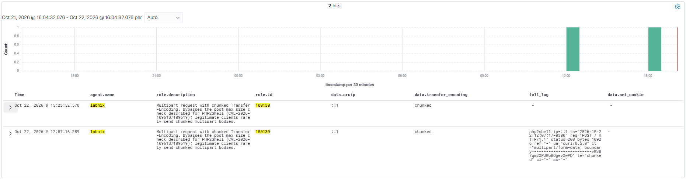

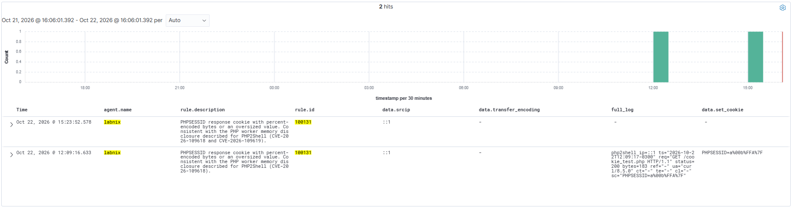

After the sibling decoder was added, a new `cookie_test.php` request produced the top row below (17:18:13). `data.phpsessid_prefix` holds the 8 character prefix `a%00b%FF`, while `full_log` and `data.set_cookie` stay empty. The two older rows are the v1.1 alert before the prefix field (15:23:52) and the v1.0 alert with the raw cookie (12:09:16).

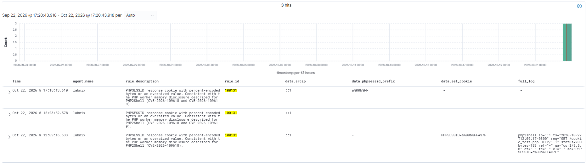

### Rules 100101 and 100120 with `same_srcip`

The v1.1 alerts (15:23:58 and 15:24:00) fire on the same OOM and HTTP 500 sequence as the v1.0 alerts of the earlier runs (11:24 and 12:10).

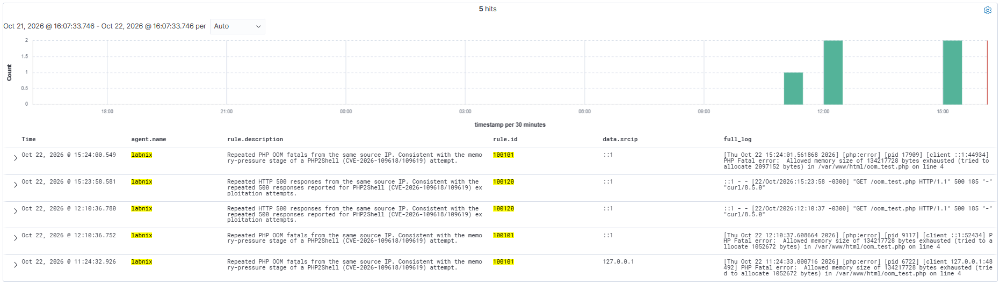

### Rules 100100 and 100101 - OOM fatals and repetition

Rule 100100 is unchanged in v1.1.


### SCA policy v1.0 - exposure on the unpatched and the patched endpoint

On the unpatched endpoint the score is 25%.

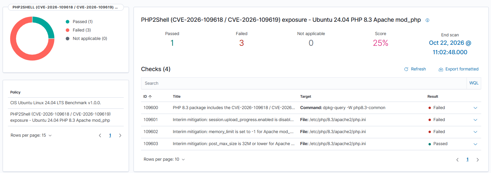

After package `php8.3-common 8.3.6-0ubuntu0.24.04.13` is installed, check 109600 changes to Passed and the score rises to 50%. Checks 109601 and 109602 stay Failed because those interim mitigations were not applied. This is the behavior that v1.1 changes, since a patched host does not need interim mitigations.

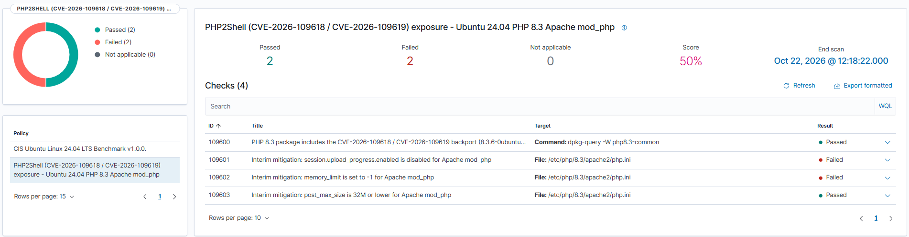

The SCA results reach the indexer as events:

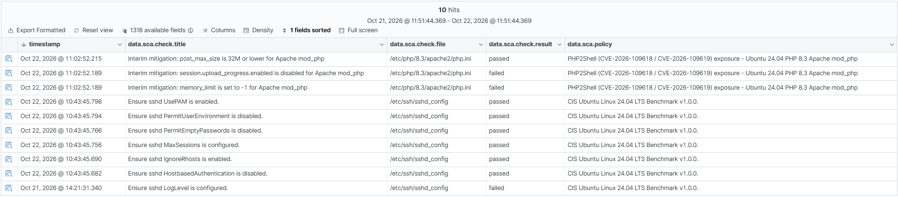

### SCA policy v1.1 - patched endpoint

With the backport installed, all five checks pass and the score is 100%. Scan end time 17:04:35. The dashboard lists only the package command as target, because the `any` condition stops at the first passing rule.

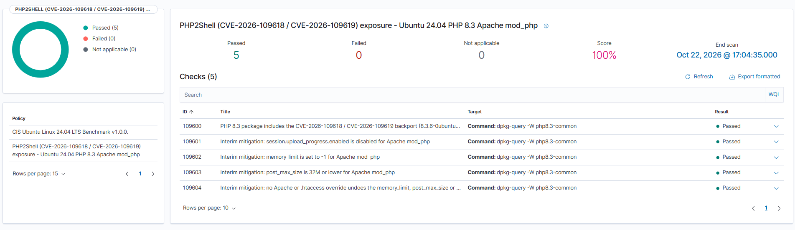

### SCA policy v1.1 - effective value computed with ini_get

To test the mitigation commands on a host that carries the backport, the package comparison in the policy was temporarily raised from `>= 13` to `>= 99` so that check 109600 fails, simulating a host without the backport. The test files were removed and the policy was restored afterwards (SHA-256 verified).

A drop-in `/etc/php/8.3/apache2/conf.d/99-php2shell-test.ini` with `memory_limit = -1`, `post_max_size = 32M` and `session.upload_progress.enabled = Off` was created. Run with the Apache `php.ini` and `conf.d`, `ini_get()` returned `-1`, `0` and `32`. Checks 109601 to 109604 pass through the PHP CLI commands and only 109600 fails. The score is 80% (scan end 17:10:07).

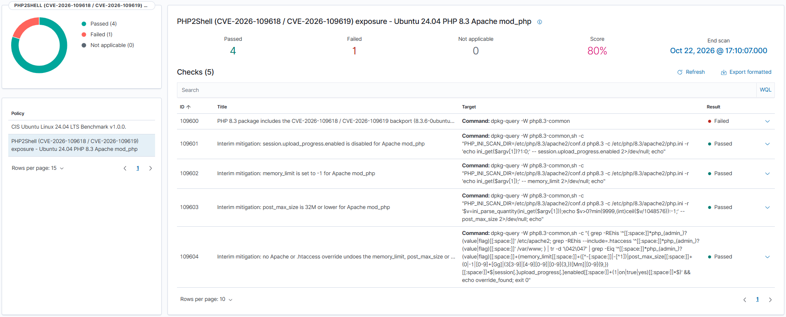

The drop-in was removed, so the directives return to `128M`, `8M` and upload progress enabled, and the line `php_value memory_limit 128M` was written to `/etc/apache2/conf-enabled/zz-php2shell-test.conf`. Checks 109601 and 109602 fail because `ini_get()` returns the unmitigated values, and check 109604 fails because of the Apache override. Check 109603 passes because the default `post_max_size` of 8M is within the 32M limit. The score is 20% (scan end 17:14:09).

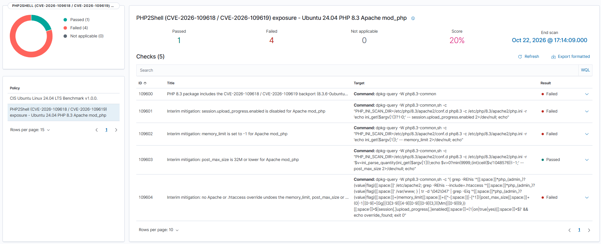

The shell logic of the five checks was also exercised outside Wazuh against 35 configurations with PHP 8.3.6: `conf.d` ordering, units (K, M, G and bytes), `0` and `-1` values, quoted values, `On`, `Off`, `0`, `No` and `false` for the boolean, overrides through symlinked Apache sites, `.htaccess` files, commented lines and upper case directive names.

---

## SCA Policy Summary

Scope: Ubuntu 24.04 LTS, PHP 8.3, Apache 2 with mod_php. The policy only runs where `/etc/php/8.3/apache2/php.ini` and the `php8.3-common` package exist.

| Check | Title | Passes when |
|---|---|---|
| 109600 | PHP 8.3 package includes the vendor backport (`8.3.6-0ubuntu0.24.04.13` or later) | The Ubuntu package revision is 13 or later |
| 109601 | `session.upload_progress.enabled` is disabled | The package has the backport, or the effective value is `Off` or `0` |
| 109602 | `memory_limit` is `-1` | The package has the backport, or the effective value is `-1` |
| 109603 | `post_max_size` is 32M or lower | The package has the backport, or the effective value is 32M or lower |
| 109604 | No Apache or `.htaccess` override undoes the mitigation | The package has the backport, or no `php_value`, `php_admin_value`, `php_flag` or `php_admin_flag` line under `/etc/apache2` or in `.htaccess` files under `/var/www` sets `memory_limit` to anything but `-1`, `post_max_size` above 32M or unlimited, or `session.upload_progress.enabled` on |

The effective value of a directive is what `ini_get()` returns when the PHP CLI is started with `-c /etc/php/8.3/apache2/php.ini` and `PHP_INI_SCAN_DIR=/etc/php/8.3/apache2/conf.d`. `post_max_size` is converted to MiB and rounded up, and `0` (unlimited) fails. Checks 109601 to 109604 use the condition `any`, so a host with the backport passes them. They are partial mitigations from the PHP advisory. Updating PHP is the only complete fix, and `memory_limit=-1` increases exhaustion risk, so pair it with a container or cgroup memory limit.

---

## Limitations

- **Session cookies in the log file.** The `php2shell` LogFormat records the full `Set-Cookie` response header, which includes every cookie the application sets in a response. Since v1.1 the decoder does not extract it, rules 100130 and 100131 omit `full_log`, and only a truncated 8 character `PHPSESSID` prefix reaches the alert, so alerts carry no cookies. Leaked memory can hold passwords, tokens and API keys (Wiz), so also restrict who can read rule 100131 alerts. The log file `php2shell_access.log` and, if `logall_json` is enabled, the Wazuh archives still contain the raw line. Treat both as sensitive: restrict the log file to `root:adm` with mode 640, keep retention short, restrict access to the archives, and enable the format only on hosts under review.
- **Rule 100110 is validated by logtest only.** Crashing a production-like worker on purpose is invasive, so no real segfault event was generated. Segfaults also have benign causes, such as defective extensions, and the rule carries no source IP because Apache logs worker exits without a client address.
- **Rule 100120 can be noisy** on sites with legitimate bursts of HTTP 500. Tune the level and frequency to your baseline.
- **Chunked detection is HTTP/1.1 only.** HTTP/2 lengthless multipart requests, also described by Calif, carry no `Transfer-Encoding` header and are not covered by rule 100130.
- **PHP-FPM was not tested.** The lab runs mod_php. The rules operate on Apache logs, but exploitation paths differ on PHP-FPM, as described by the researchers. The policy reads the Apache SAPI configuration only and does not cover FPM pool settings.
- **SCA effective values come from the files of the Apache SAPI.** `ini_get()` reflects `php.ini` and `conf.d` and needs the `php8.3-cli` package. Check 109604 searches `/etc/apache2` and `.htaccess` files under `/var/www`. It does not read `.htaccess` files elsewhere, configuration included from outside `/etc/apache2`, `[PATH=]` and `[HOST=]` sections, or values set by the application at runtime. `post_max_size` overrides are matched for values in M, G or 9 or more digits of bytes.
- **The SCA policy is specific to Ubuntu 24.04 with PHP 8.3 and Apache mod_php.** Other distributions and PHP branches need their own revision checks.

---

## Remediation

Apply the PHP security update. This is the only complete fix.

```bash
# Ubuntu 24.04 - package revision with the backport
apt update && apt install libapache2-mod-php8.3 php8.3-cli php8.3-common php8.3-opcache php8.3-readline
systemctl restart apache2
```

Fixed upstream in PHP 8.5.12, 8.4.27, 8.3.36 and 8.2.35, with source backports for 7.4, 8.0 and 8.1 listed in the advisory. For interim mitigations, see SCA checks 109601 to 109604 and the PHP advisory. On PHP 8.5 the advisory also lists `fatal_error_backtraces=0`, which this policy does not check because it targets PHP 8.3.

---

## Author

**Kislley Rodrigues** (m0us3r) - Wazuh Ambassador | Detection Engineering | Blue Team

## Wazuh

This project was developed as part of the [Wazuh Ambassador Program](https://wazuh.com/ambassadors-program/?utm_source=ambassadors&utm_medium=referral&utm_campaign=ambassadors+program).

Wazuh is a free, open source security platform that provides unified XDR and SIEM capabilities. Learn more at [wazuh.com](https://wazuh.com/?utm_source=ambassadors&utm_medium=referral&utm_campaign=ambassadors+program).

## Validation environment

The rules, decoder and SCA policy were validated in a lab with the following versions:

- Wazuh manager: 4.14.8
- Agent OS: Ubuntu 24.04.5 LTS
- Web server: Apache 2.4.58 (prefork, mod_php)
- PHP: 8.3.6 (package 8.3.6-0ubuntu0.24.04.13 is the patched build)

## Acknowledgments

Special thanks to Katia Bukcovac and Farouk Musa from the Wazuh team for their support of the Ambassador Program and for the technical review of this work.
