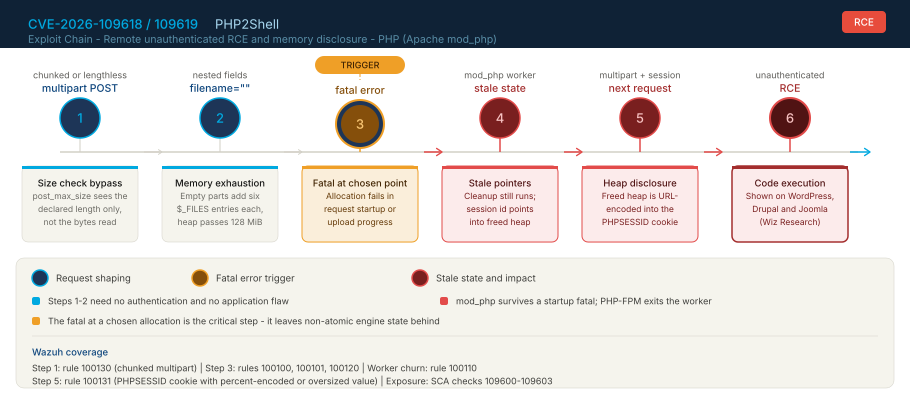
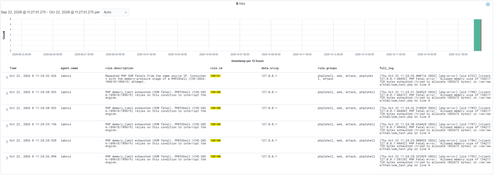
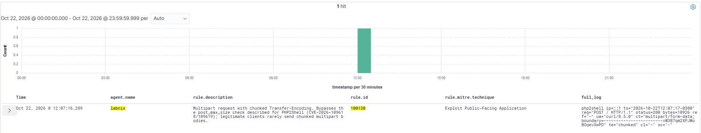
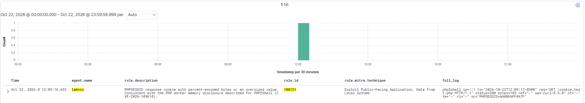
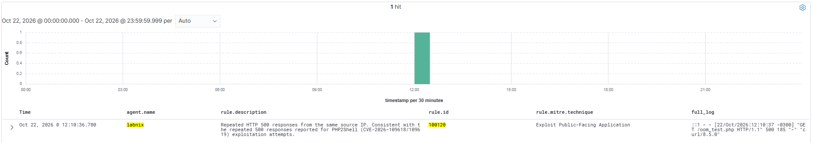

# PHP2Shell Detection with Wazuh 4.14.8 (4.14.x series) - CVE-2026-109618 and CVE-2026-109619

> **Detection engineering for the PHP2Shell memory-safety flaws · Apache mod_php on Linux · lab-validated on Ubuntu 24.04 LTS**

Wazuh 4.14.8 | 6 rules | 1 decoder pair | SCA policy with 4 checks | MITRE T1190, T1499, T1005 | CVSS v4 9.2

---

## What is PHP2Shell?

PHP2Shell is a family of memory-safety bugs in the PHP engine. A fatal error, most usefully an out-of-memory fatal at `memory_limit`, interrupts a non-atomic internal operation and leaves state behind that later code trusts. The flaws are remote and unauthenticated, do not depend on a bug in the application, and reach back to PHP 5.4 according to the researchers.

Two CVEs describe the issues:

- **CVE-2026-109618**: upload-progress unserializer use-after-free, plus a remote process-memory disclosure where reclaimed heap contents are URL-encoded into a `PHPSESSID` response cookie.
- **CVE-2026-109619**: fatal-error backtrace use-after-free and an OPcache type confusion.

Researchers demonstrated unauthenticated RCE against WordPress, Drupal and Joomla.

Because the exploit runs below the application layer, application logs show little. The Wiz advisory lists the observable signals this repository detects: multipart requests followed by memory-limit errors, repeated HTTP 500 responses, malformed or oversized `PHPSESSID` response cookies, and PHP worker churn.

> Disclosed by Wiz Research (Sagi Tzadik, Shir Tamari, Nir Ohfeld, Tomer Schwartz), with a technical write-up by Calif. Fixed in PHP 8.5.12, 8.4.27, 8.3.36 and 8.2.35.

---

## Official References

| Resource | Link |
|---|---|
| PHP security advisory (2026-10-21) | https://www.php.net/archive/2026.php#2026-10-21-5 |
| Wiz Research write-up | https://www.wiz.io/blog/php2shell-php-rce |
| Calif technical write-up | https://calif.io/php2shell/ |
| Wazuh rules syntax | https://documentation.wazuh.com/current/user-manual/ruleset/ruleset-xml-syntax/rules.html |
| Wazuh decoders syntax | https://documentation.wazuh.com/current/user-manual/ruleset/ruleset-xml-syntax/decoders.html |
| Wazuh custom SCA policies | https://documentation.wazuh.com/current/user-manual/capabilities/sec-config-assessment/creating-custom-policies.html |
| MITRE ATT&CK T1190 | https://attack.mitre.org/techniques/T1190/ |

---

## Why a Dedicated Detection Layer

An unpatched PHP engine cannot be told apart from a patched one by looking at `php -v` on distributions that backport the fix. On Ubuntu 24.04 the package `8.3.6-0ubuntu0.24.04.13` contains the fix while `php -v` still reports 8.3.6. Detection therefore has two independent layers:

```
Layer 1 - Behavior (rules)   : OOM fatals, repeated 500s, worker churn,
                               chunked multipart, anomalous PHPSESSID cookie
Layer 2 - Exposure (SCA)     : package revision with the backport,
                               interim mitigations from the PHP advisory
```

The rules detect the observable pre-conditions and symptoms described in the official sources. A single event does not prove exploitation, and the rule descriptions say "consistent with" on purpose.

---

## Exploit Chain

```
Step 1: multipart POST          chunked or lengthless body bypasses post_max_size
Step 2: filename="" parts       nested empty-filename parts exhaust memory_limit
Step 3: fatal error     [!]     TRIGGER - allocation fails at a chosen point
Step 4: stale state             cleanup still runs in mod_php, pointers reference freed heap
Step 5: next multipart request  freed heap is URL-encoded into the PHPSESSID cookie
Step 6: RCE                     unauthenticated code execution (WordPress, Drupal, Joomla)
```



`post_max_size` is compared with the declared `Content-Length`, not with the bytes actually read, so chunked HTTP/1.1 and lengthless HTTP/2 multipart requests bypass it. On mod_php the request cleanup still runs after a startup fatal, which is why mod_php carries the highest risk. On PHP-FPM a startup failure exits the worker, and exploitation needs a post-startup decoding operation.

---

## Repository Structure

```
PHP2Shell-Detection-with-Wazuh-4.14.8/
│
├── rules/
│   └── php2shell_rules.xml                  # 6 Wazuh rules (100100-100131)
│
├── decoders/
│   └── php2shell_decoders.xml               # decoder pair for the php2shell access log
│
├── apache/
│   └── php2shell-logformat.conf             # LogFormat and CustomLog for Apache 2.4
│
├── sca/
│   └── php2shell_cve_2026_109618_109619.yml # SCA policy - Ubuntu 24.04, PHP 8.3, mod_php
│
└── docs/
    ├── exploit_chain_timeline.svg           # Exploit chain diagram (self-contained SVG)
    ├── 01_sca_php2shell_vulnerable.png      # SCA result on the unpatched endpoint
    ├── 02_discover_rules_100100_100101_full_log.png
    ├── 03_discover_rule_100130_chunked_multipart.png
    ├── 04_discover_rule_100131_percent_encoded_cookie.png
    ├── 05_discover_rule_100120_repeated_http_500.png
    └── 06_sca_php2shell_patched.png         # SCA result after the vendor patch
```

---

## Detection Architecture

### Rule Chain

| Rule | Parent | Signal | Level | Evidence |
|---|---|---|---|---|
| **100100** | 30301 | PHP `Allowed memory size ... exhausted` fatal in the Apache error log | 6 | Logtest and Discover |
| **100101** | 100100, same source IP | 6 OOM fatals in 120 s from one IP | 10 | Logtest and Discover |
| **100110** | 30304, frequency | 4 Apache worker segmentation faults in 120 s | 13 | Logtest only |
| **100120** | 31122, same source IP | 5 HTTP 500 responses in 60 s from one IP | 8 | Logtest and Discover |
| **100130** | php2shell-accesslog | Multipart request with `Transfer-Encoding: chunked` | 7 | Logtest and Discover |
| **100131** | php2shell-accesslog | `PHPSESSID` response cookie with `%XX` bytes or 64+ characters | 10 | Logtest and Discover |

> **Engineering notes from validation on Wazuh 4.14.8**
>
> - The native PHP fatal chain (31402, 31405, 31420) does not match the Apache 2.4 error log format. In `wazuh-logtest` the event stops at rule 30301, so rule 100100 inherits from 30301 and matches the message itself.
> - Native Apache 2.4 segfault events end at rule 30304, not 30104. Frequency rules count only events whose final matched rule is the referenced SID, so 100110 uses 30304.
> - Access log events with status 500 end at rule 31122, so 100120 uses 31122 and not 31120.
> - The native `web-accesslog` decoder has a prematch that accepts extra tokens before the bracketed timestamp, so any combined-style prefix is claimed by it. The `php2shell` format is key=value without brackets, which the native decoder does not match.

### Decoder

The `php2shell-accesslog` decoder and its child extract `srcip`, `protocol` (method), `url`, `id` (status), `content_type`, `transfer_encoding`, `content_length` and `set_cookie` from the custom access log line.

---

## Deployment

### Step 1 - Add the Apache log format (endpoint)

Add the two lines from `apache/php2shell-logformat.conf` inside the VirtualHost you want to monitor, then validate and reload:

```bash
apachectl configtest && systemctl reload apache2
chown root:adm /var/log/apache2/php2shell_access.log && chmod 640 /var/log/apache2/php2shell_access.log
```

### Step 2 - Collect the logs (endpoint `ossec.conf`)

```xml
<localfile>
  <log_format>apache</log_format>
  <location>/var/log/apache2/error.log</location>
</localfile>

<localfile>
  <log_format>apache</log_format>
  <location>/var/log/apache2/access.log</location>
</localfile>

<localfile>
  <log_format>syslog</log_format>
  <location>/var/log/apache2/php2shell_access.log</location>
</localfile>
```

The first two feed the native Apache rules that rules 100100, 100110 and 100120 inherit from. The third feeds the decoder for rules 100130 and 100131.

### Step 3 - Deploy decoder and rules (manager)

```bash
cp decoders/php2shell_decoders.xml /var/ossec/etc/decoders/
cp rules/php2shell_rules.xml /var/ossec/etc/rules/
chown wazuh:wazuh /var/ossec/etc/decoders/php2shell_decoders.xml /var/ossec/etc/rules/php2shell_rules.xml
chmod 660 /var/ossec/etc/decoders/php2shell_decoders.xml /var/ossec/etc/rules/php2shell_rules.xml

# Syntax check - silent on success
/var/ossec/bin/wazuh-analysisd -t

systemctl restart wazuh-manager
```

`wazuh-logtest` reads the running `wazuh-analysisd`, so the manager restart is required before testing new rules or decoders.

### Step 4 - Deploy the SCA policy (endpoint)

```bash
mkdir -p /var/ossec/etc/custom-sca
cp sca/php2shell_cve_2026_109618_109619.yml /var/ossec/etc/custom-sca/
chown root:wazuh /var/ossec/etc/custom-sca/php2shell_cve_2026_109618_109619.yml
chmod 640 /var/ossec/etc/custom-sca/php2shell_cve_2026_109618_109619.yml
```

Register it inside the `<sca>` block of the endpoint `ossec.conf` and restart the agent:

```xml
<sca>
  <enabled>yes</enabled>
  <scan_on_start>yes</scan_on_start>
  <interval>12h</interval>
  <policies>
    <policy>/var/ossec/etc/custom-sca/php2shell_cve_2026_109618_109619.yml</policy>
  </policies>
</sca>
```

```bash
systemctl restart wazuh-agent
```

A local policy loaded from an absolute path does not require `sca.remote_commands`.

---

## Validation

### Decoder and rules by logtest (manager)

```bash
cat <<'EOF' | /var/ossec/bin/wazuh-logtest 2>&1 | grep -E '^\s+(name|srcip|url|transfer_encoding|set_cookie|id|level):|Alert to be generated|full event'
php2shell ip=127.0.0.1 ts="2026-10-22T11:45:00-0300" req="POST / HTTP/1.1" status=200 bytes=531 ref="-" ua="curl/8.5.0" ct="multipart/form-data; boundary=------------------------abc" te="chunked" cl="-" sc="-"
php2shell ip=127.0.0.1 ts="2026-10-22T11:45:00-0300" req="GET /cookie_test.php HTTP/1.1" status=200 bytes=531 ref="-" ua="curl/8.5.0" ct="-" te="-" cl="-" sc="PHPSESSID=a%00b%FF%41%7F%7F; path=/"
php2shell ip=10.0.0.9 ts="2026-10-22T11:45:00-0300" req="GET /x.php HTTP/1.1" status=200 bytes=531 ref="-" ua="curl/8.5.0" ct="-" te="-" cl="-" sc="PHPSESSID=abcdefghijklmnopqrstuvwxyz012345; path=/"
EOF
```

Observed result: line 1 fires 100130 (level 7), line 2 fires 100131 (level 10), and line 3, a normal 32-character session ID, fires nothing.

### Real events on the lab endpoint

These steps generate events with benign requests. They reproduce the observable symptoms, not an exploit.

```bash
# Rule 100130 - multipart request with chunked Transfer-Encoding
curl -s -o /dev/null -w 'HTTP %{http_code}\n' -H 'Transfer-Encoding: chunked' -F 'a=b' http://localhost/
```

```php
<?php
// Lab test: benign trigger that emits a percent-encoded PHPSESSID response cookie.
setcookie('PHPSESSID', "a\x00b\xffA\x7f");
```

```bash
# Rule 100131 - save the script above as /var/www/html/cookie_test.php
curl -si http://localhost/cookie_test.php | grep -i '^set-cookie'
```

```php
<?php
// Lab test: benign memory_limit exhaustion (lab only, never on a production host).
$a = [];
while (true) { $a[] = str_repeat('A', 1048576); }
```

```bash
# Rules 100100, 100101 and 100120 - save the script above as /var/www/html/oom_test.php
for i in 1 2 3 4 5 6; do curl -s -o /dev/null -w '%{http_code} ' http://localhost/oom_test.php; done; echo
```

---

## Validation Evidence

All screenshots come from the Wazuh Dashboard Discover on the lab agent `labnix`. Environment: Wazuh 4.14.8 manager, Ubuntu 24.04.5 endpoint, Apache 2.4.58 prefork with mod_php 8.3.6.

### SCA policy on the unpatched endpoint


### SCA policy after the vendor patch

Package `php8.3-common 8.3.6-0ubuntu0.24.04.13` installed. Check 109600 changes to Passed and the score rises from 25% to 50%. Checks 109601 and 109602 stay Failed because those interim mitigations were not applied in the lab.


### Rules 100100 and 100101 - OOM fatals and repetition



### Rule 100130 - chunked multipart request



### Rule 100131 - percent-encoded PHPSESSID response cookie



### Rule 100120 - repeated HTTP 500 responses



---

## SCA Policy Summary

Scope: Ubuntu 24.04 LTS, PHP 8.3, Apache 2 with mod_php. The policy only runs where `/etc/php/8.3/apache2/php.ini` and the `php8.3-common` package exist.

| Check | Title | Source |
|---|---|---|
| 109600 | PHP 8.3 package includes the vendor backport (`8.3.6-0ubuntu0.24.04.13` or later) | Ubuntu package revision |
| 109601 | `session.upload_progress.enabled` is disabled | PHP advisory, interim measure |
| 109602 | `memory_limit` is `-1` | PHP advisory, interim measure |
| 109603 | `post_max_size` is 32M or lower | PHP advisory |

Checks 109601 to 109603 are partial mitigations from the PHP advisory. Updating PHP is the only complete fix, and `memory_limit=-1` increases exhaustion risk, so pair it with a container or cgroup memory limit.

---

## Limitations

- **Session cookie exposure in the log.** The `php2shell` LogFormat records the full `Set-Cookie` response header. Legitimate session IDs and other cookies set by the application are written to `php2shell_access.log`. Treat that file as sensitive: restrict it to `root:adm` with mode 640, keep retention short, and enable the format only on hosts under review.
- **Rule 100110 is validated by logtest only.** Crashing a production-like worker on purpose is invasive, so no real segfault event was generated. Segfaults also have benign causes, such as defective extensions, and the rule carries no source IP because Apache logs worker exits without a client address.
- **Rule 100120 can be noisy** on sites with legitimate bursts of HTTP 500. Tune the level and frequency to your baseline.
- **Chunked detection is HTTP/1.1 only.** HTTP/2 lengthless multipart requests, also described by Calif, carry no `Transfer-Encoding` header and are not covered by rule 100130.
- **PHP-FPM was not tested.** The lab runs mod_php. The rules operate on Apache logs, but exploitation paths differ on PHP-FPM, as described by the researchers.
- **The SCA policy is specific to Ubuntu 24.04 with PHP 8.3 and Apache mod_php.** Other distributions and PHP branches need their own revision checks.

---

## Remediation

Apply the PHP security update. This is the only complete fix.

```bash
# Ubuntu 24.04 - package revision with the backport
apt update && apt install libapache2-mod-php8.3 php8.3-cli php8.3-common php8.3-opcache php8.3-readline
systemctl restart apache2
```

Fixed upstream in PHP 8.5.12, 8.4.27, 8.3.36 and 8.2.35, with source backports for 7.4, 8.0 and 8.1 listed in the advisory. For interim mitigations, see SCA checks 109601 to 109603 and the PHP advisory.

---

## Author

**Kislley Rodrigues (m0us3r)**
Wazuh Ambassador | Detection Engineering | Blue Team

---

## Wazuh

This project was developed as part of the [Wazuh Ambassador Program](https://wazuh.com/ambassadors-program/?utm_source=ambassadors&utm_medium=referral&utm_campaign=ambassadors+program).

Wazuh is a free, open source security platform that provides unified XDR and SIEM protection.
Learn more at [wazuh.com](https://wazuh.com/?utm_source=ambassadors&utm_medium=referral&utm_campaign=ambassadors+program).

*Rules, decoder and SCA policy validated on Wazuh 4.14.8 and Ubuntu 24.04.5 LTS with Apache 2.4.58 and PHP 8.3.6.*
